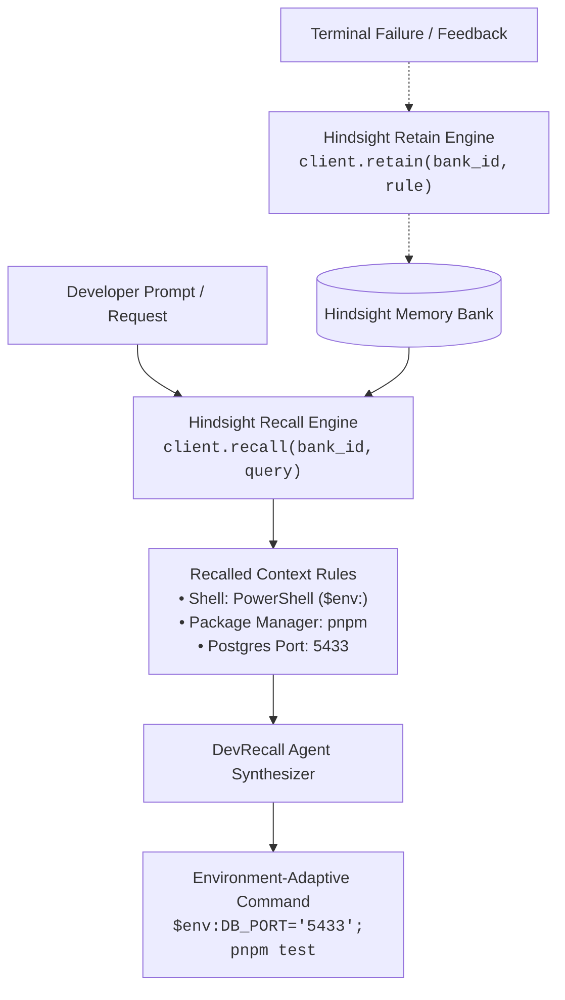

# DevRecall 🧠⚡

> **Continuous Environment Memory for Developer Agents**  
> Powered by [Vectorize Hindsight](https://github.com/vectorize-io/hindsight) Agent Memory.

[](https://python.org)
[](https://hindsight.vectorize.io/)
[](LICENSE)

---

## The Problem: Agent Amnesia & Environment Drift

Every time you launch a CLI coding assistant, it starts with total amnesia:
* It generates Linux `export` commands on **Windows PowerShell**.
* It recommends `npm test` inside strict **`pnpm`** monorepos.
* It attempts to spin up Docker services on **port 5432**, colliding with local databases.

When developers have to repeatedly correct their AI tools about local setup quirks, developer productivity plummets. **DevRecall** solves this by equipping terminal agents with persistent memory via **Hindsight**, allowing the agent to retain workstation rules and recall them before synthesizing commands.

---

## Architecture



---

## Before vs. After Adding Hindsight

| Developer Request | Naive Agent (No Memory) | DevRecall (With Hindsight Memory) |
| :--- | :--- | :--- |
| **"Set test env vars and run tests"** | `export NODE_ENV=test && npm test`<br>*(Fails on Windows PowerShell; wrong package manager)* | `$env:NODE_ENV='test'; $env:DB_PORT='5433'; pnpm test`<br>*(PowerShell syntax + pnpm applied automatically)* |
| **"Spin up local Postgres container"** | `docker run -p 5432:5432 postgres`<br>*(Collides with local database on 5432)* | `docker run -p 5433:5432 postgres`<br>*(Recalls host port collision rule)* |
| **"Activate virtualenv and install deps"** | `source .venv/bin/activate`<br>*(Fails on Windows: `source` not found)* | `.\\.venv\\Scripts\\Activate.ps1; pip install -r requirements.txt`<br>*(Native PowerShell virtualenv invocation)* |

---

## Quickstart

### 1. Installation

Clone this repository and install dependencies:

```bash
git clone https://github.com/your-username/devrecall.git
cd devrecall
pip install -r requirements.txt
```

### 2. Run the 2-Minute Cinematic Demo

Experience the before-and-after contrast live in your terminal:

```bash
python main.py demo
```

This runs a 3-phase simulation showcasing the naive agent failure, the `Hindsight.retain()` operation, and the subsequent `Hindsight.recall()` augmented resolution.

---

## CLI Usage

### Query DevRecall with Memory Recall
```bash
python main.py query "How do I set test environment variables and run our tests?"
```

### Manually Retain a Workstation Rule
```bash
python main.py retain "Local Docker Postgres should map host port 5433 to avoid port 5432 conflicts"
```

### Inspect Currently Stored Memory Units
```bash
python main.py list
```

### Clear Memory Bank
```bash
python main.py clear
```

---

## Hindsight Integration Details

DevRecall connects directly to Vectorize's Hindsight client:

```python
from hindsight_client import Hindsight

client = Hindsight(base_url="http://localhost:8888")

# 1. Retain an environment rule
client.retain(
    bank_id="devrecall-bank",
    content="Host environment: Windows 11 using PowerShell 7. Always use $env:KEY='val'.",
    tags=["environment", "powershell", "windows"]
)

# 2. Recall rules before synthesizing terminal commands
results = client.recall(
    bank_id="devrecall-bank",
    query="How do I set environment variables?"
)
```

DevRecall also includes a resilient local engine fallback if running in offline demo environments.

---

## Resources & Documentation

* **Hindsight GitHub:** [vectorize-io/hindsight](https://github.com/vectorize-io/hindsight)
* **Hindsight Documentation:** [hindsight.vectorize.io](https://hindsight.vectorize.io/)
* **Vectorize Agent Memory Guide:** [vectorize.io/what-is-agent-memory](https://vectorize.io/what-is-agent-memory)

---

## License

MIT License. Built for developer agent workflows.
